# 点评

# Session

session的原理是cookie


# 校验登录状态

## 拦截器（需要登陆的路径）

用户请求进入拦截器以后，1拦截器会去获取请求头中的token，2根据token去redis中获取用户信息。若存在，3保存到ThreadLocal中，4刷新token有效期，5放行

## 但如果访问的是不需要登陆的路径，那么token有效期就不会刷新。所以需要在上面拦截器A之前，再加一个拦截器B，在B中拦截一切路径。

1获取token，2查询redis中用户信息，3保存到ThreadLocal，4刷新token有效期，5放行。

### 这样，拦截器A

只需要查询ThreadLoacl中的用户，不存在则拦截，存在则继续。


# Session共享问题

多态Tomcat并不共享session存储空间，当请求切换到不同tomcat服务时导致数据丢失问题


# 基于Redis实现共享session登录


# 更新缓存有太多无效性操作

# 先删除缓存，再操作数据库

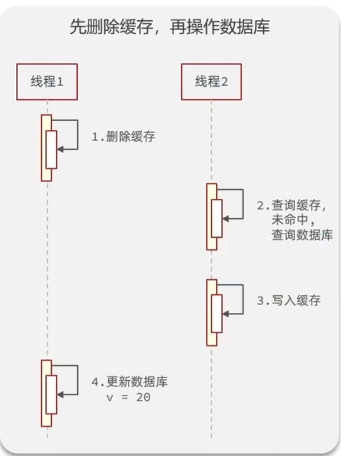

# 先操作数据库，再删除缓存


# 缓存穿透

缓存穿透是指客户端请求的数据再缓存中和数据库中都不存在，这样缓存永远都不会生效，这些请求都会打到数据库。

## 缓存空对象

数据库查询到空对象后，直接在redis中缓存null

优点：实现简单，维护方便

缺点：额外的内存消耗（设置短TTL），可能存在短期的不一致（用户请求了一个id，不存在，redis中设置了null，就在此时在数据库中插入了这个id。）（控制ttl的时间，或插入后主动把数据插入到缓存中）

## 布隆过滤器


客户端和Redis之间，加一层布隆过滤器

优点：内存占用小，没有多余key

缺点：实现复杂，存在误判

## 增加id的复杂度，避免被猜测id规律

## 做好数据基础格式校验

## 加强用户权限校验

## 做好热点参数的限流

# 缓存雪崩

缓存雪崩是指在同一时段大量的缓存key同时失效或者redis服务直接宕机，导致大量请求道道数据库，带来巨大压力。

## 给不同的key的ttl添加随机值

## 利用redis集群提高服务的可用性

## 给缓存业务添加降级限流策略

浏览器（静态数据）

nginx

redis

jvm

## 给业务添加多级缓存

# 缓存击穿

缓存击穿问题也叫热点key问题，就是一个被高并发访问并且**缓存重建业务较复杂**的key突然失效了，无数的请求访问会在瞬间给数据库带来巨大的冲击


## 互斥锁（一致性）

只有获取锁成功的人才能**重建缓存数据**


## 逻辑过期（永不过期）（可用性）

在存储一个数据时，在value中添加一个过期时间， 


# 用setnx互斥锁解决缓存击穿


## double check 的作用是：

> 抢到锁之后，再确认一次缓存是否已经被其他线程重建好了，避免重复查数据库、重复写缓存。
> 
> 

举个并发场景：

1. 缓存刚好过期。

2. 线程 A 查 Redis，没查到。

3. 线程 A 抢到锁。

4. 线程 A 查数据库。

5. 线程 B、C、D 也查 Redis，没查到。

6. B、C、D 抢锁失败，等待重试。

7. 线程 A 查完数据库，把数据写入 Redis，释放锁。

8. 线程 B 重试后抢到锁。

如果没有 double check，线程 B 会直接查数据库，然后写 Redis。接着 C、D 也可能依次抢到锁、查数据库、写 Redis。

这样互斥锁虽然避免了“同时很多线程查数据库”，但变成了“排队一个个查数据库”。数据库压力还是比预期大。

加了 double check 后，线程 B 抢到锁后会先再查一次 Redis：

这时发现线程 A 已经把缓存写好了，B 就直接返回缓存，不再查数据库。

# 基于逻辑过期方式解决缓存击穿问题


## double check 逻辑总结：

在逻辑过期方案中，线程发现缓存过期后，会先尝试获取互斥锁。只有获取锁成功的线程才有资格重建缓存。

但获取锁成功后，不能马上重建缓存，需要再查一次 Redis，这一步就是 double check。

原因是：当前线程第一次查询 Redis 时，缓存是过期的；但在它等待锁、获取锁的这段时间里，可能已经有其他线程完成了缓存重建。所以拿到锁后要重新查询 Redis，判断缓存是否仍然过期。

如果第二次查询发现缓存已经未过期，说明其他线程已经重建好了缓存，当前线程直接返回最新缓存，并释放锁，不需要再重建。

如果第二次查询发现缓存仍然过期，说明还没有其他线程完成重建，当前线程才开启异步线程去重建缓存。


# 全局唯一ID

## 唯一性

redis increment

## 高可用

任何时候来找你都能生成正确的id。

redis集群

## 高性能

保证生成id的速度足够快

redis以性能著称

## 递增性

确保整体的主键变大，有利于数据库创建索引，提高插入时的速度

redis也是采用自增方案

## 安全性

再利用redis的increment方案时，不要直接使用redis自增的数值，而是拼接一些其他信息

符号位（1bit）\+时间戳31（bit）\+序列号（32bit）

符号位：永远为0

时间戳：以秒为单位，可以使用69年

序列号：32bit，秒内的计数器，可以支持每秒产生2^32个不同ID

## 生成策略

### UUID

​	使用jdk自带的uuid工具类，生成的是16进制的一长串的数值，字符串结构，也不是单调递增的特性。

### Redis自增

​	时间戳+自增id计数器

​	每天一个key，方便统计订单量，限定key自增的值不会太大

### snowflake算法，雪花算法

​	要维护机器id，性能比redis好一点

### 数据库自增


# 秒杀


# 超卖问题


## 加锁

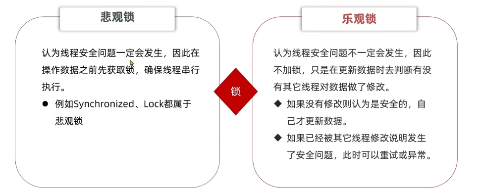

## 悲观锁（性能差）

认为线程安全一定会发生，因此在操作数据之前先获取锁，确保线程**串行执行**。Synchronized，Lock

## 乐观锁（成功率低，对数据库压力大）

认为线程安全问题不会发送，因此不加锁，只是在更新数据时判断有没有其他线程对数据做了修改
怎么判断？？

### 版本号法

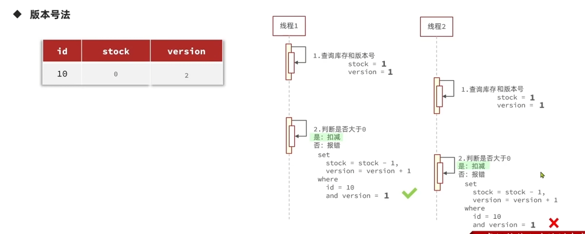

​	查询时查询库存和**版本号**，更新时加一个where id =10 **and version = 1**

### CAS法 compare and swap

​	不再有版本，**拿版本代替库存**，第一次查询到库存为a，则更新时，判断where id = 10 **and stock =  a**

​	如何解决成功率低的问题？

​		由于**库存比较特殊只要大于0就行**：判断where id = 10 **and stock > 0**

​		分段锁：把数据里的资源分成几份，存到多个表里，抢的时候去多张表里去抢


# 一人一单

要求同一个优惠券，一个用户只能下单
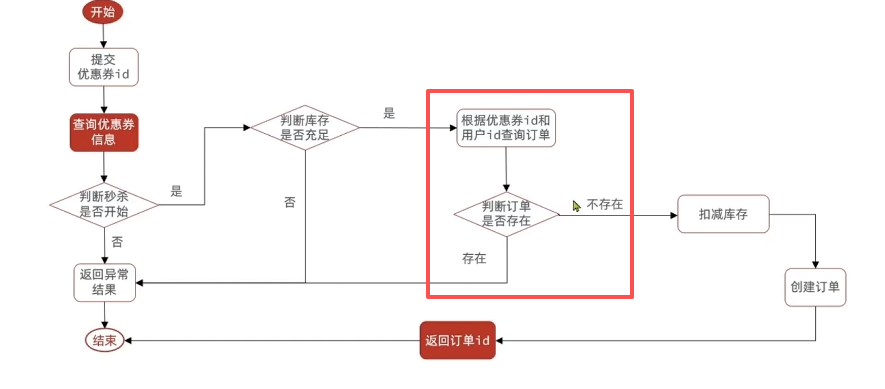

## 加锁

```
synchronized(userId.toString().intern()) {
```

意思是：**用当前用户 id 对应的字符串对象作为锁，让同一个用户的多个并发请求串行执行，避免一人多单。**

**为什么要 toString()？**

因为 `synchronized` 需要锁的是一个对象。`userId` 是 `Long`，直接这样也能写：

```
synchronized(userId) {
```

但不推荐。`Long` 这种包装类型对象来源不稳定，可能是不同对象，也可能受缓存机制影响，而且锁包装类型本身容易引发问题。


**为什么要 intern()？**

关键在这里。即使两个请求的用户 id 都是 `101`，每次执行：

```
userId.toString()
```

也可能产生两个不同的字符串对象：

```
new String("101")
new String("101")
```

内容一样，但对象地址不同。`synchronized` 判断锁是否相同，看的是**对象地址**，不是字符串内容。


**`synchronized` 要放在事务方法外面，是为了避免锁先释放、事务后提交，导致后续线程查不到前一个线程未提交的订单，从而破坏“一人一单”。**


### @Transactional 失效问题

在同一个类内部直接调用了带事务的方法：

```
return createVoucherOrder(voucherId);
```

而 `createVoucherOrder()` 和 `seckillVoucher()` 都在 `VoucherOrderServiceImpl` 这个类里。

Spring 的 `@Transactional` 本质是通过代理对象实现的。也就是说，事务不是方法自己天然有的，而是 Spring 给这个对象包了一层代理：

```
Controller
   -> Spring 代理对象
      -> 开启事务
      -> 调用 createVoucherOrder()
      -> 提交/回滚事务
```

但你现在是类内部自己调用自己：

```
seckillVoucher()
   -> this.createVoucherOrder()
```

这种调用没有经过 Spring 代理对象，而是直接调用当前对象的普通方法，所以代理增强不会执行，`@Transactional` 就不会生效。

简单说：

> 只有通过 Spring 代理对象调用 `@Transactional` 方法，事务才会生效；本类内部直接调用，相当于普通 Java 方法调用，事务不会开启。

所以这段代码有问题：

```
synchronized(userId.toString().intern()) {
    return createVoucherOrder(voucherId);
}
```

它实际等价于：

```
synchronized(userId.toString().intern()) {
    return this.createVoucherOrder(voucherId);
}
```

没有走代理。

常见解决方式是拿到当前类的代理对象，再调用事务方法：

```
IVoucherOrderService proxy =
        (IVoucherOrderService) AopContext.currentProxy();

synchronized (userId.toString().intern()) {
    return proxy.createVoucherOrder(voucherId);
}
```
## 集群模式（跨jvm）下synchronized锁失效

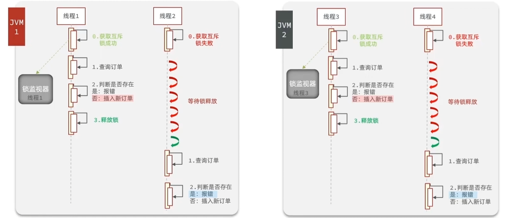

只能锁单个jvm，不能锁多个jvm

## 分布式锁

满足分布式系统或集群模式下**多进程可见**（多jvm可见）并**互斥**的锁。

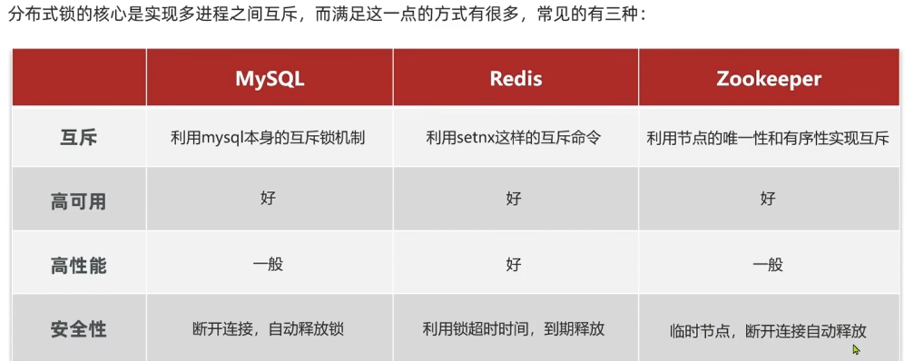

### Mysql

mysql本身的互斥锁机制

断开连接，可以自动释放锁

### Zookeeper

利用节点的唯一性和有序性实现互斥

### Redis

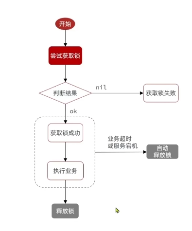

利用setnx这样的互斥命令

获取锁：互斥：确保只有一个线程获取锁

​		非阻塞：尝试一次，成功返回true，失败返回false

释放锁：手动释放

​		超时释放：获取锁时添加一个超时时间

要确保**setnx lock thread1**和**expire lock 10**同时成功或者同时失败，保证原子性。`SET lock thread1 EX 10 NX`

### **误删问题**

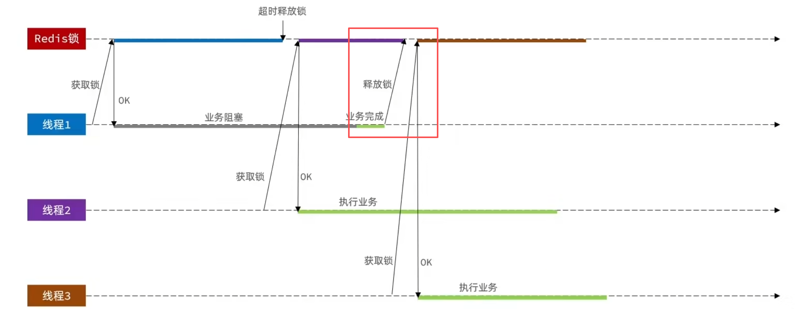

如果**没有判断“这把锁是不是当前线程自己的”**。极端情况下：

1. 线程 A 获取锁，锁 10 秒过期。
2. A 执行业务超过 10 秒。
3. 锁自动过期，线程 B 获取同一把锁。
4. A 执行完，调用 `unlock()`。
5. A 把 B 的锁删了。

这就是误删锁问题。

### 删除锁之前，要判断锁标识是否是自己的

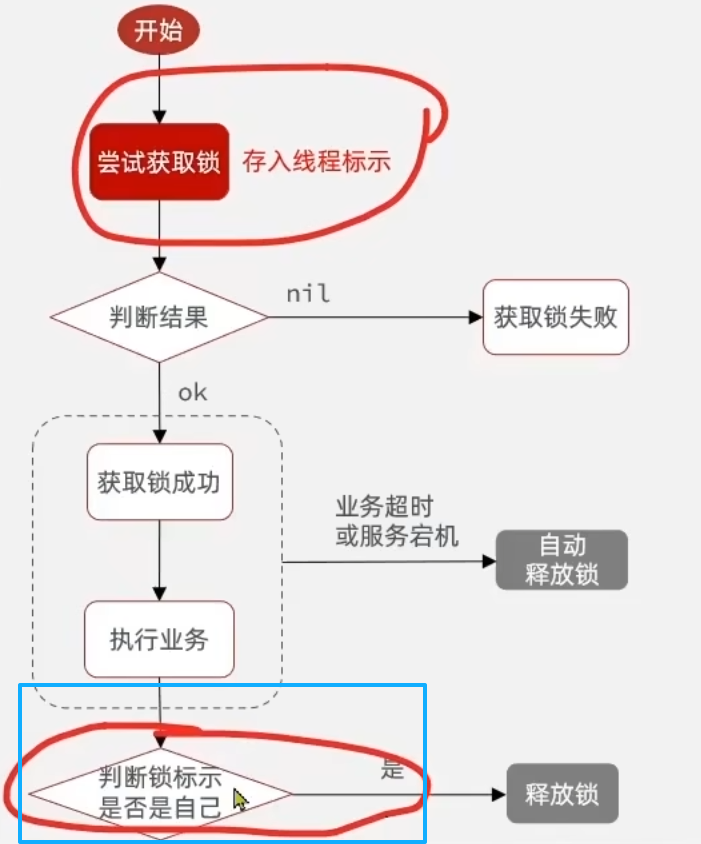

如何判断？**先取出 Redis 里锁的 value，再和当前线程自己的锁标识比较**。

```
key   = "lock:" + 业务名称；例如：key = "lock:" + "order" + userId
value = UUID前缀 + "-" + 线程ID；例如value = UUID.randomUUID().toString(true) + "-" + Thread.currentThread().getId()
```

加 `userId` 是为了让锁的粒度变成：**同一个用户只能同时下一个单，不同用户互不影响**。

还是会出现误删的问题，因为判断锁标识和释放锁是两个动作。两个动作之间出现了阻塞，要确保这两个动作的原子性。

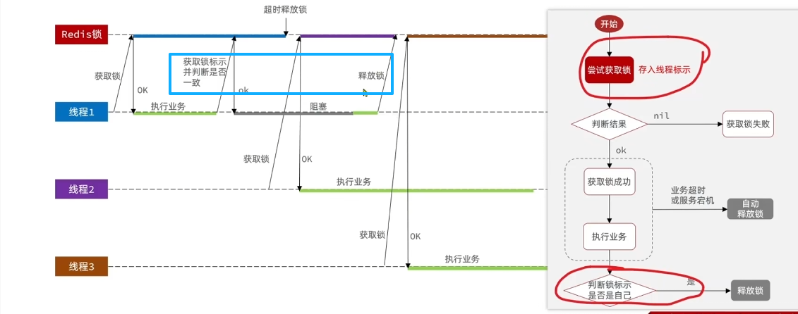


### Redis的Lua脚本

Redis提供了Lua脚本功能，在一个脚本中编写多条redis命令，确保多条命令执行的原子性。

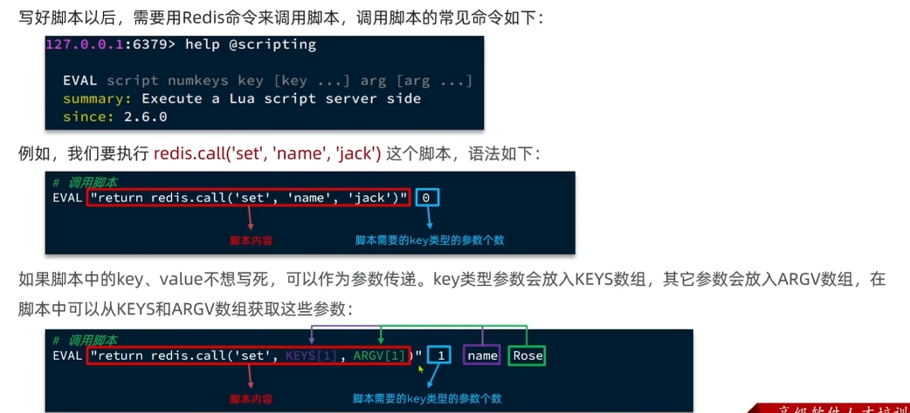

Lua脚本确保了**判断锁标识和释放锁是原子的**

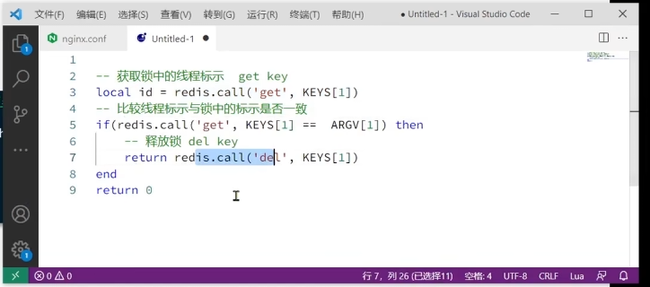

# 基于Redis的分布式锁优化

基于setnx实现的分布式锁存在下面的问题

## 1不可重入

同一个线程无法多次获取同一把锁

## 2不可重试

获取锁值尝试一次就返回false，没有重试机制

## 3超时释放

锁超时释放虽然可以避免死锁，但如果是业务执行耗时较长，也会导致锁释放，存在安全隐患。

## 4主从一致性

如果redis提供了主从集群， 主从同步有延迟，如果主节点刚写入锁，还没来得及同步给从节点，主节点就宕机了；这时从节点被提升为新的主节点，但它没有那把锁，于是其他线程还能再次加锁成功，导致分布式锁失效。

# Redisson

redisson是一个在Redis的基础上实现的Java驻内存数据网课（In-Memory Data Grid）。它不仅提供了一系列的分布式的Java常用对象，还提供了许多分布式服务

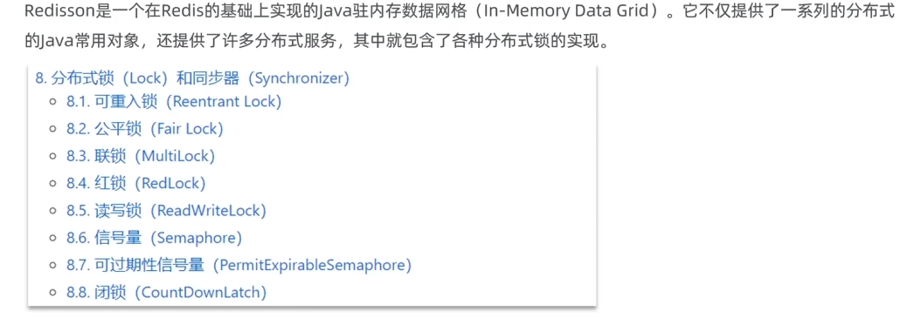

1引入依赖 

2配置redisson客户端（RedissonConfi配置类，其中redissonClient() 是创建对象的方法，该方法的返回值Redisson.create(config) 返回一个 RedissonClient 实现对象，交给spring容器管理））

3 用@Resource引入RedissonClient对象 getLock unlock

## Redisson可重入锁原理

使用redis的hash类型结构，多记录一个重入次数值

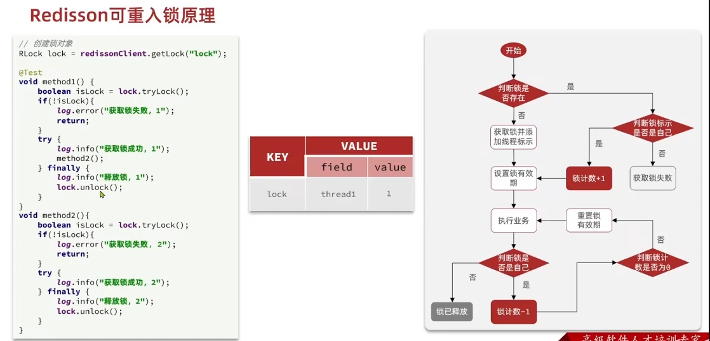

整个逻辑必须用lua脚本，来确保获取锁和释放锁的原子性

释放锁的lua脚本：

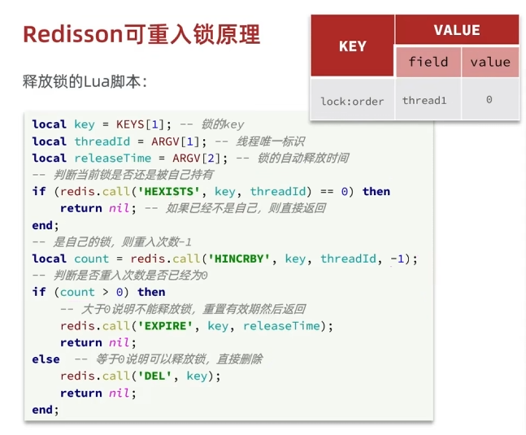

## 基于Redis的分布式锁优化

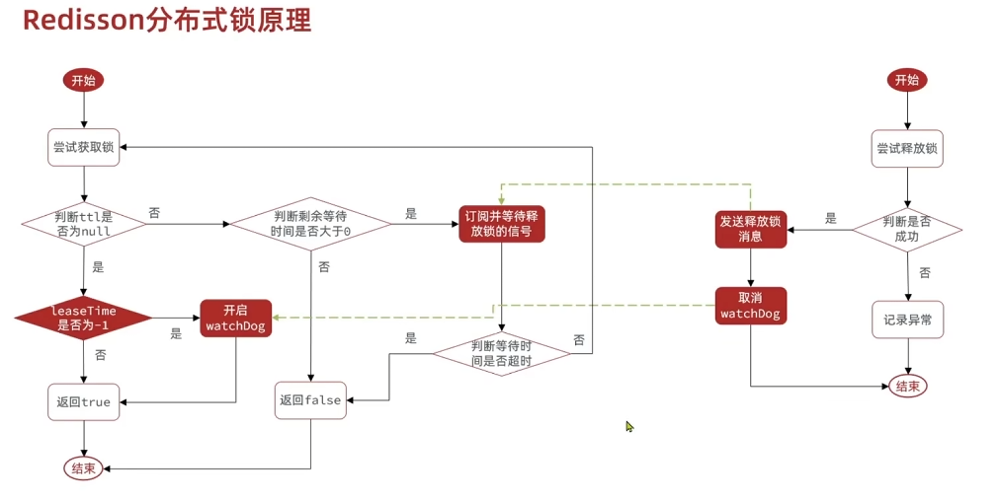

分布式锁原理

可重入：利用hash结构记录线程id和重入次数

可充式：利用信号量和Pub Sub功能实现等待、唤醒，获取锁失败的重试机制

超时续约：利用watchDog，每隔一段时间，重置超时时间

## 主从一致性问题

multi lock，多个独立节点，必须在每个节点都获取到锁，才能够加锁成功。

可以解决主节点宕机，从节点没有同步锁的数据，导致锁失效的问题。


# 异步秒杀思路

## redis优化秒杀

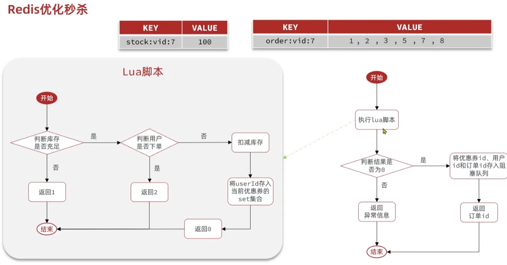

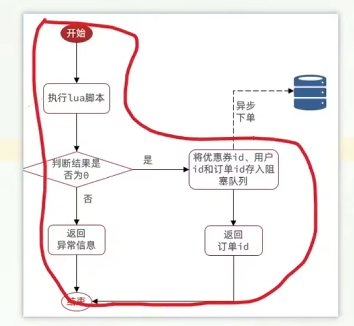

## 阻塞队列

阻塞队列,当一个线程尝试从该队列中获取元素时，如果它没有元素，则被阻塞，直到队列中有元素，才会被唤醒

基于jdk阻塞队列（在jvm以内 ）的问题：

队列存满时，可能导致内存溢出，内存限制问题。

基于内存保存订单信息，如果服务宕机，内存里的订单信息会丢失。

​	取出来订单去处理，但是出现了问题，这个订单没有完成就消失了。  

## 用redis实现消息队列

基于List实现消息队列，值得注意的是，当队列中没有消息时RPOP或者LPOP操作会返回null，不想JVM的阻塞队列那样会阻塞并等待。

BRPOP BLPOP

基于List的消息队列有哪些优缺点?
优点:
	利用Redis存储，不受限于JVM内存上限
	基于Redis的持久化机制，数据安全性有保证
	可以满足消息有序性
缺点:
	无法避免消息丢失
	只支持单消费者

### 基于Pub Sub的消息队列

是Redis2.0版本引入的消息传递模型。消费者可以订阅一个或多个channel，生产者向对应channel发送消息后，所有订阅者都能收到相关消息。

优点：采用发布订阅模型，支持多生产，多消费

缺点：不支持数据持久化；无法避免消息丢失；消息堆积有上线，超出时数据丢失（消费者缓存空间有上限）。可靠性较低。

### 基于Stream的消息队列-单消费模式

Stream是Redis5.0引入的一种新数据类型，可以实现一个功能非常完善的消息队列。

特点：

- 消息可回溯
- 一个消息可以被多个消费者读取
- 可以阻塞读取
- 有消息漏读风险

XADD

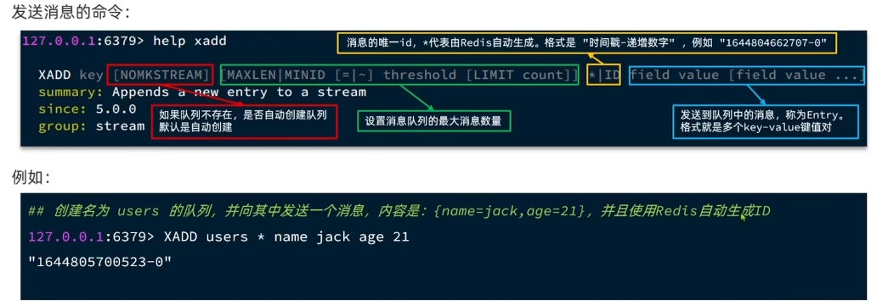

XREAD

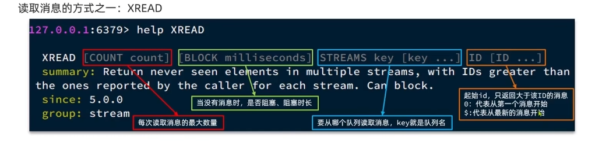

在业务开发中，我们可以循环的调用XREAD阻塞方式来查询最新消息，从而实现持续监听队列的效果。

**注意：**当我们指定起始ID为$时，代表读取最新的消息，如果我们处理一条消息的过程中，又有超过1条以上的消息到达队列，则下次获取时也只能获取到最新的一条，会出现漏读消息的问题。

### 基于Stream的消息队列-消费者组

消费者组(Consumer Group):将多个消费者划分到一个组中，监听同一个队列。具备下列特点:

- **消息分流**：队列中的消息会分流给组内的不同消费者，而不是重复消费，从而加快消息处理的速度。

- **消息标示**：消费者组会维护一个标示，记录最后一个被处理的消息，哪怕消费者宕机重启，还会从标示之后读取消息。确保每一个信息都会被消费

- **消息确认**：消费者获取消息后，消息处于pending状态，并存入一个pending-list。当处理完成后，需要通过XACK来确认消息，标记消息为已处理，才会从pending-list移除。

  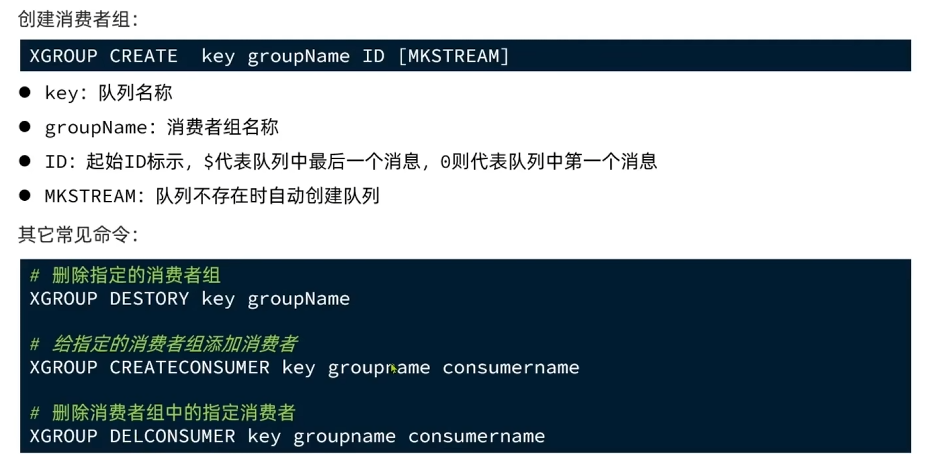

  XREADGROUP命令特点：

  - 消息可回溯：消息被消费完了并不会直接删除，其他人也可以拿
  - 可以多消费者争抢消息，加快消费速度
  - 可以阻塞读取
  - 没有消息漏读风险
  - 有消息确认机制，保证消息至少被消费一次
  - 独立与jvm以外，不受jvm的内存限制；可以做持久化

  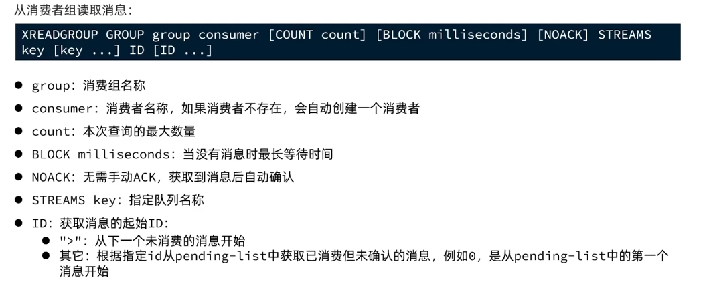

  ​

    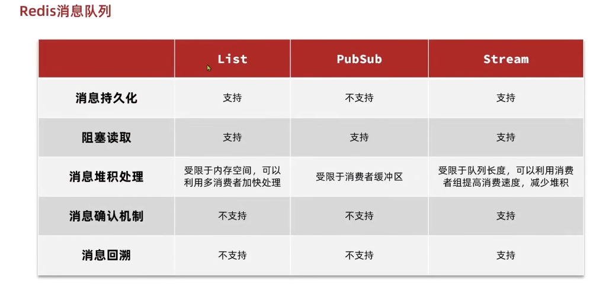

